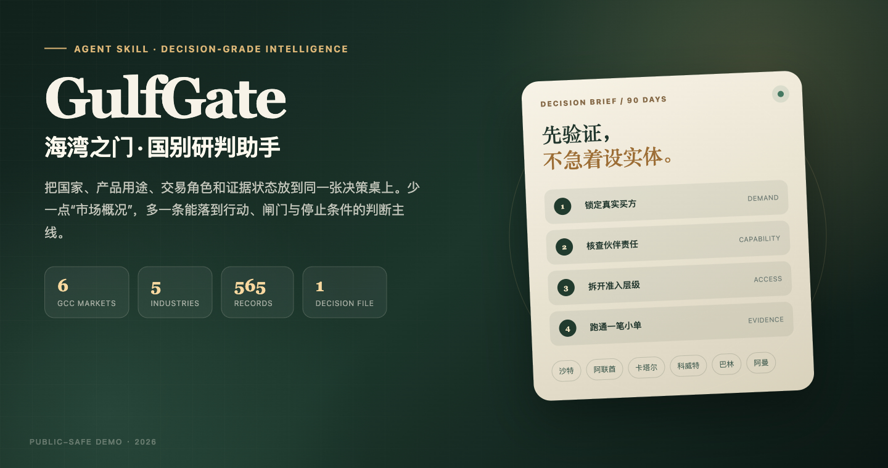
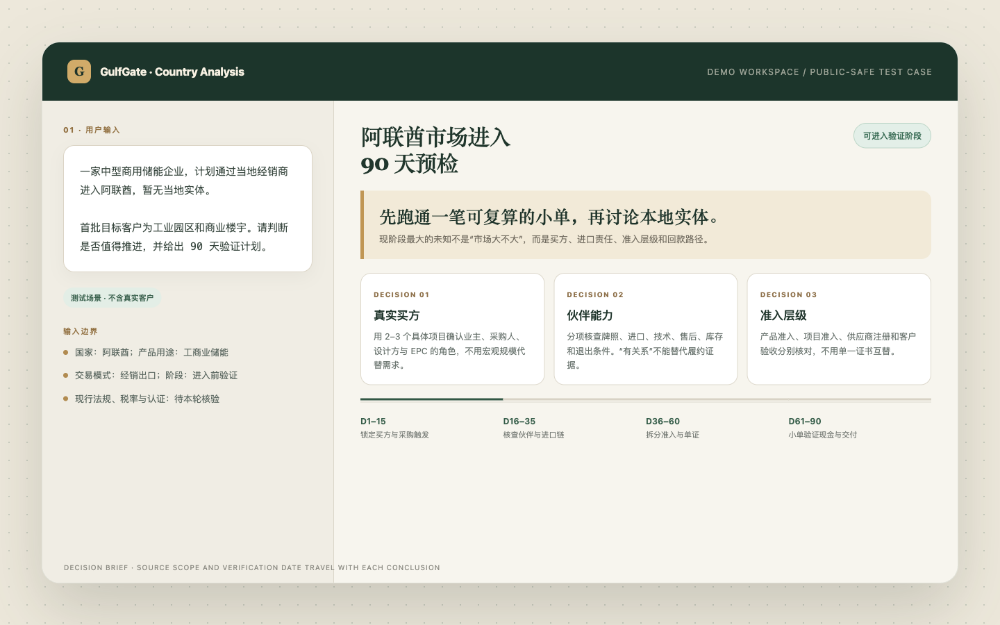
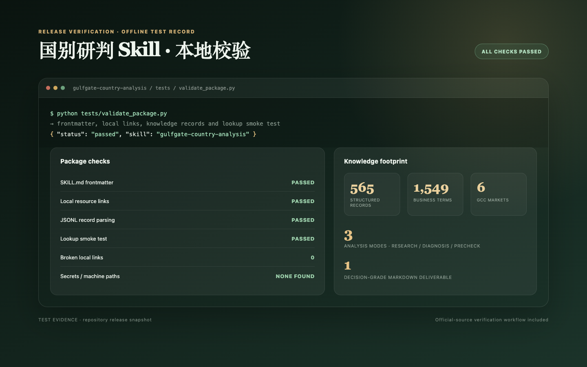

# GulfGate — مساعد تحليل الدول

<p><a href="README.md"><u>简体中文</u></a> · <a href="README.en.md"><u>English</u></a> · <a href="README.ar.md"><u>العربية</u></a></p>

<div align="center">
  
</div>

> حوّل المعلومات المتفرقة عن دول الخليج الست إلى مذكرة قرار يمكن لفريق العمل مناقشتها وتوزيع المسؤوليات فيها والتوقف عندما لا تدعم الأدلة استمرار الاستثمار.

[](SKILL.md)
[](#نطاق-التغطية)
[](#التثبيت)
[](tests/validate_package.py)

هذه ليست أداة عامة لإنتاج «تقرير عن السوق في الشرق الأوسط». بل تفصل بين الدولة والنطاق التنظيمي واستخدام المنتج ودور الشركة في الصفقة وحالة الأدلة ومرحلة التنفيذ، ثم تجيب عن أربعة أسئلة إدارية:

1. هل نتقدم؟
2. ما الخطوة الأولى؟
3. ما الشروط التي يجب تحققها قبل زيادة الاستثمار؟
4. ما الإشارة التي تستدعي التوقف أو تغيير المسار أو الانسحاب؟

## لماذا نحتاج هذا المساعد؟

معظم أخطاء التوسع الخارجي لا تنشأ من نقص المعلومات، بل من دمج مستويات مختلفة من الأدلة في استنتاج واحد:

- حجم السوق الكبير يُفسر خطأً كإيرادات يمكن للشركة الوصول إليها؛
- علاقة ودية مع شريك تُفسر خطأً كقدرة على التنفيذ؛
- شهادة منتج تُفسر خطأً كموافقة على المشروع والاستخدام؛
- بقاء الموقع الإلكتروني متاحًا يُفسر خطأً كاستمرار نفاذ القاعدة؛
- اجتماعان لا يكفيان لتبرير عرض سعر أو توقيع أو تكديس مخزون.

يعيد GulfGate كل توصية إلى دليل أو حساب أو افتراض تخطيطي معلن.

## عرض توضيحي

<div align="center">
  
</div>

مثال على الطلب:

```text
استخدم $gulfgate-country-analysis.
نحن شركة متوسطة الحجم لتخزين الطاقة التجارية، ونخطط لدخول الإمارات عبر موزع محلي
دون كيان محلي حاليًا. العملاء المستهدفون في البداية هم المجمعات الصناعية والمباني
التجارية. حدد ما إذا كان ينبغي المضي قدمًا، وأعد خطة تحقق لمدة 90 يومًا.
```

راجع المثال الكامل في [examples/analysis-demo.md](examples/analysis-demo.md).

## أوضاع العمل

| الوضع | وقت الاستخدام | الناتج النموذجي |
| --- | --- | --- |
| البحث | استكشاف فرصة أو مقارنة أسواق أو التخطيط للدخول | فرضية سوق، سلسلة المشتري، مقارنة المسارات، خطة تحقق |
| التشخيص | توجد خطة سابقة ويجب فحص منطقها وأدلتها | نقاط الخطأ، فجوات الأدلة، ترتيب الإصلاح، شروط إعادة التقييم |
| الفحص المسبق | قبل المناقصة أو التوقيع أو التأسيس أو الالتزام بموارد كبيرة | شروط المضي أو التوقف، بوابات المراحل، شروط الانسحاب |

ينتج عن المهام المعقدة ملف Markdown واحد مكتفٍ بذاته، تتضمن الجداول والمخططات والملاحظات المرجعية داخله.

## التثبيت

```bash
git clone https://github.com/origami3521905038-hash/gulfgate-country-analysis.git
mkdir -p ~/.codex/skills
cp -R gulfgate-country-analysis ~/.codex/skills/
```

يجب نسخ المجلد كاملًا. تعد `references/` و`assets/` و`scripts/` جزءًا من موارد التشغيل.

## نطاق التغطية

- الأسواق: السعودية، الإمارات، قطر، الكويت، البحرين، عُمان
- القطاعات: الطاقة المتجددة، مواد البناء والمقاولات، التجارة الإلكترونية والإلكترونيات الاستهلاكية، الأجهزة الطبية، المنتجات الصناعية الخفيفة
- سلسلة الأعمال: الفرص السوقية، المنظومة التجارية، فحص الشركاء، التواصل الثقافي، الوصول والمناقصات، العقود والتحصيل، التسليم والعمليات المحلية، الامتثال وإدارة الأزمات
- الموارد: 565 سجلًا منظمًا، و1,549 مصطلحًا تجاريًا، وملفات معرفية للدول والقطاعات، وثمانية ملفات منهجية

## أدلة الاختبار

<div align="center">
  
</div>

يتحقق اختبار الإصدار من بيانات الترويسة والروابط المحلية ومسارات المعرفة وتحليل JSONL واختبار أداة البحث المحلية. يشغل GitHub Actions الاختبار نفسه عند كل دفعة وطلب دمج.

نجاح الاختبار يثبت سلامة بنية الحزمة وتشغيل الأدوات، ولا يثبت أن كل حكم تنظيمي أو ضريبي أو متعلق بالشهادات ما زال ساريًا في الوقت الحالي.

## حدود الاستخدام

يقدم هذا المساعد منهجية بحث وأدوات استرجاع تاريخية، ولا يستبدل رأي مختص قانوني أو ضريبي أو طبي أو هندسي أو جهة تنظيمية. يجب التحقق من الحقائق التنظيمية والحساسة للوقت من المصادر الرسمية، مع تسجيل تاريخ النشر ونطاق التطبيق وتاريخ التحقق.

لا تتضمن الحزمة صلاحية بحث أو مفتاح API أو خدمة خلفية. وعندما لا يستطيع المضيف الوصول إلى الإنترنت، يكون الناتج الصحيح هو حالة «غير مُتحقق» وخطة تحقق واضحة.

## المشروع المرافق

توجد مهارة تدريب الموظفين الجدد على الحكم في مستودع منفصل: [GulfGate Country Training](https://github.com/origami3521905038-hash/gulfgate-country-training).

## المشاركون في الإنشاء

أُنجز هذا المشروع بالتعاون بين [@origami3521905038-hash](https://github.com/origami3521905038-hash) و[@18719203981lkr-spec](https://github.com/18719203981lkr-spec).

نرحب بالمساهمات عبر Issues وPull Requests. راجع [CONTRIBUTING.md](CONTRIBUTING.md).

## الترخيص

لا يوجد ترخيص مفتوح مرفق حتى الآن. تبقى حقوق النشر للمشاركين في إنشاء المشروع، ويلزم الحصول على إذن كتابي قبل إعادة الاستخدام العام أو الاستخدام التجاري أو إعادة التوزيع.

