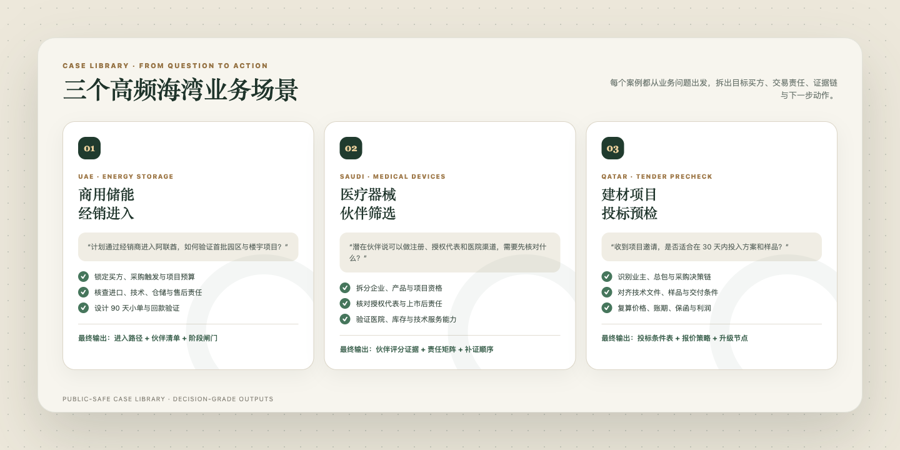

# GulfGate Country Analysis Skill

<p><a href="README.md"><u>简体中文</u></a> · <a href="README.en.md"><u>English</u></a> · <a href="README.ar.md"><u>العربية</u></a></p>

<div align="center">
  
</div>

> Turn fragmented information about the six GCC markets into a clear business decision that a team can discuss, assign, and execute.

[](SKILL.md)
[](#coverage)
[](#install)
[](tests/validate_package.py)

GulfGate brings country, jurisdiction, product use, transaction role, evidence status, and execution stage into one analysis framework, then answers four management questions:

1. Should we proceed?
2. What should happen first?
3. What must be true before we increase investment?
4. What signal should make us pause, change course, or exit?

## One input, an executable result

- **Entry sequence:** which market, customer, and commercial path to prioritize;
- **Decision evidence:** what the team needs for demand, buyers, partners, access, delivery, and collection;
- **Action roadmap:** 30/60/90-day actions, owners, milestones, and scale-up conditions;
- **Executive brief:** one view of the opportunity, cost, critical variables, next steps, and resource commitment.

## Built for these teams

| Role | What you get |
| --- | --- |
| Founder / regional lead | Market comparison, entry sequence, resource priorities, and stage gates |
| Sales / commercial | Buyer and partner assessment, purchasing chain mapping, deal and collection path |
| Project / delivery | Access, import, installation, acceptance, and local operating checklist |
| Legal / compliance | Structured review of jurisdiction, product use, evidence layers, and escalation items |

## Three high-frequency cases

<div align="center">
  
</div>

1. **UAE · Commercial energy-storage distribution:** move from “find a distributor” to buyers, importer responsibility, technical service, and a 90-day pilot.
2. **Saudi Arabia · Medical-device partner screening:** separate entity registration, product access, authorized representation, project eligibility, and service capability.
3. **Qatar · Construction-materials bid precheck:** align buyer, procurement eligibility, technical files, delivery, and payment conditions before pricing.

## Demo

<div align="center">
  
</div>

Example request:

```text
Use $gulfgate-country-analysis.
We are a mid-sized commercial energy-storage company planning to enter the UAE
through a local distributor, with no local entity yet. Initial targets are
industrial parks and commercial buildings. Decide whether to proceed and create
a 90-day validation plan.
```

See the full public-safe example and case library in [examples/analysis-demo.md](examples/analysis-demo.md).

## Three operating modes

| Mode | Use it when | Typical output |
| --- | --- | --- |
| Research | Exploring an opportunity, comparing markets, or planning entry | Market hypothesis, buyer chain, path comparison, validation plan |
| Diagnosis | You already have a proposal and need an evidence audit | Failure points, evidence gaps, repair order, conditions for reconsideration |
| Precheck | Before bidding, signing, incorporating, or committing major resources | Proceed/pause conditions, stage gates, stop conditions |

Complex tasks produce one self-contained Markdown deliverable. Tables, diagrams, and source notes stay inside the same file.

## Install

```bash
git clone https://github.com/origami3521905038-hash/gulfgate-country-analysis.git
mkdir -p ~/.codex/skills
cp -R gulfgate-country-analysis ~/.codex/skills/
```

Install the complete directory. The Skill ships with its `references/`, `assets/`, and `scripts/` resources.

Run the offline package check:

```bash
cd gulfgate-country-analysis
python tests/validate_package.py
```

## Coverage

- Markets: Saudi Arabia, United Arab Emirates, Qatar, Kuwait, Bahrain, and Oman
- Industry entry points: renewable energy, construction materials and contracting, cross-border e-commerce and consumer electronics, medical devices, and light industrial products
- Business chain: market opportunity, commercial ecosystem, partner diligence, cross-cultural engagement, access and tendering, contracts and collection, delivery and local operations, compliance and crisis management
- Assets: 565 structured records, 1,549 business terms, country and industry knowledge files, and eight method files

## Test evidence

<div align="center">
  
</div>

The release check validates frontmatter, local links, knowledge paths, JSONL parsing, and the local lookup smoke test. GitHub Actions runs the same check on every push and pull request.

The same checks run automatically with every update, keeping knowledge structure, lookup scripts, document links, and release files consistent.

## Official-source verification chain

For policy, pricing, access, project status, and legal requirements, the Skill prioritizes the competent authority and the official source text, then tracks publication date, scope, version evidence, and verification date.

Decision-grade reports keep the key source beside the corresponding conclusion, making the full chain from source to judgment, impact, and action easy to review. Hosts with web access can verify in real time; the local knowledge base continues to support analysis, case comparison, and evidence checklists.

## Companion project

The onboarding and judgment-training Skill lives in a separate repository: [GulfGate Country Training](https://github.com/origami3521905038-hash/gulfgate-country-training).

## Co-creators

This project was jointly created by [@origami3521905038-hash](https://github.com/origami3521905038-hash) and [@18719203981lkr-spec](https://github.com/18719203981lkr-spec).

See [CONTRIBUTORS.md](CONTRIBUTORS.md) for the full attribution record. Contributions are welcome through issues and pull requests. See [CONTRIBUTING.md](CONTRIBUTING.md).

## License

Copyright is jointly held by both co-creators. Contact the authors to discuss public reuse, commercial collaborations, industry expansion, or custom editions.

